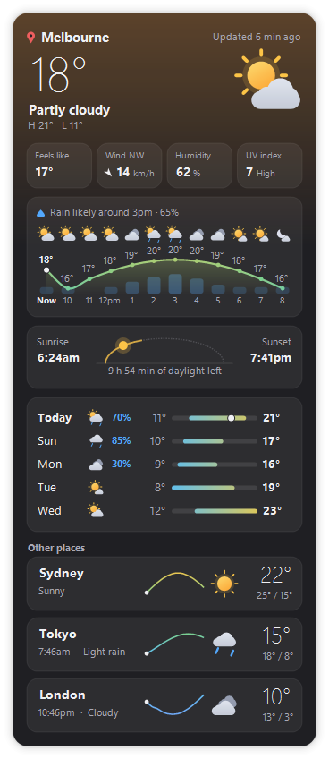
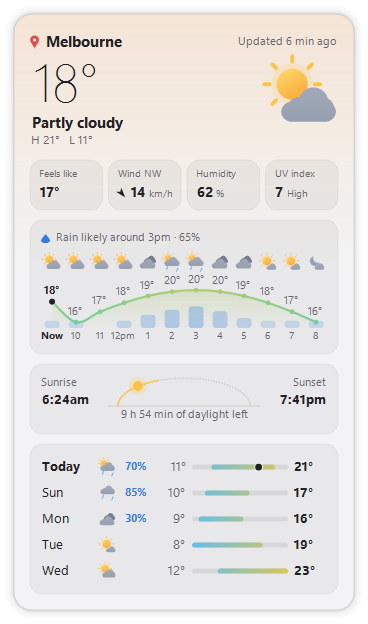
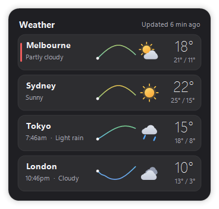
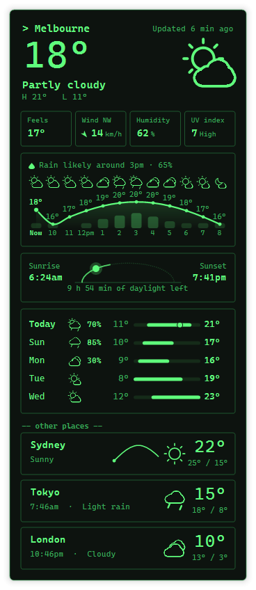

# Kinetik Weather: weather forecast widget for the Windows desktop

**Kinetik Weather** is a free, open-source **weather widget for Windows 11 and Windows 10**. It shows the current conditions, the next hours as a temperature curve with their chance of rain, sunrise and sunset, and the week ahead, right on your desktop, for one place or several at once. Forecasts come from [Open-Meteo](https://open-meteo.com/): no account, no API key.

It's a small portable app with no installer. It's a companion to [Kinetik](https://github.com/WastedDesigner/Kinetik), the taskbar system monitor, and [Kinetik Calendar](https://github.com/WastedDesigner/KinetikCalendar), and shares their look.

  
  

  
  

> **About this project:** I made this for my own desktop and decided to share it in case anyone else finds it useful. If you run into a bug or have an idea for a feature, please open an issue.

## Features

- **Now:** a big temperature, what it's like and the day's high and low, over a soft wash of the sky's colour
- **Details:** feels-like, wind (with an arrow for its direction), humidity and the day's UV index
- **Next hours:** 6, 8 or 12 hours ahead (or 24, every other hour) as a smooth temperature curve, with an icon for each hour
- **Chance of rain:** a bar for each hour behind the curve, and a line saying when rain is most likely
- **Sunrise and sunset**, with the sun's place on its path across the sky and how much daylight is left
- **Days ahead:** 3, 5 or 7 days, each with its chance of rain and its low-to-high range against the whole week's
- **Any place in the world:** search by name, or type coordinates
- **Several places at once:** add up to eight under right-click → Places. Show just the main place, the main place in full with the others as compact rows below it, or every place as a compact row (local time, conditions, the next 12 hours as a little line, and the day's range). Click a row to make that place the main one
- **Works offline:** the last forecast is kept, so the widget fills in at once at startup and keeps showing it without internet
- **°C or °F, km/h, mph or m/s, 12- or 24-hour time**
- **Themes** in the Kinetik apps' style, including green, amber and yellow **terminal** themes (monospace text and line-drawn icons), a choice of fonts, size and background opacity
- **Placement:** on the desktop, a normal window or always on top; drag anywhere, snap to edges, lock, click-through
- **Double-click** for a live rain radar map of your place (Windy.com)
- **Settings backup** next to the exe, offered again on a fresh Windows

## Download and use

1. Download `KinetikWeather.zip` from Releases and extract it anywhere.
2. Run `KinetikWeather.exe`. The first time, it asks where you are.
3. Right-click the widget or the tray icon for places, what to show, units, style, placement and backup.

Settings are kept in `HKCU\Software\KinetikWeather`, and the last forecasts in `%LOCALAPPDATA%\KinetikWeather`: the main place's in `forecast.json`, the others' in `places\`, listed in `places.tsv` (Kinetik Screen reads these for its Weather page). The only network requests are to Open-Meteo, for each place's forecast (every 30 minutes by default) and for place names when you search.

## Requirements

Windows 10 or 11 (64-bit) with .NET Framework 4.8, which ships with both.

## Building from source

No SDK needed: `build.bat` compiles `KinetikWeather.cs` with the .NET Framework compiler that ships with Windows. `build.bat package` also makes `KinetikWeather.zip` for a release.

`KinetikWeather.exe --demo` runs a separate copy with a made-up forecast (nothing is fetched) that reads and saves no settings. Add `--theme Light` (or any theme name) to pick its theme, `--view 0`, `1` or `2` for how its four made-up places are shown, `--place "-37.81,144.96"` to fetch a real place instead, and `--shot file.png` to draw the card into a PNG and quit, which is how the screenshots were made.

## Credits

Weather data by [Open-Meteo.com](https://open-meteo.com/), under [CC BY 4.0](https://creativecommons.org/licenses/by/4.0/).

## Tests and packaging

`python tests/run-tests.py` runs the regression checks (no window opens). `build.bat package` builds the exe and makes the release zip, checking every file in it against its SHA-256 hash. The shared support code (`SuiteSupport.cs`) is compiled into the exe, so there's no extra DLL.

## License

[GPL-3.0-or-later](LICENSE). Copyright © 2026 Akila Sella Hennedige.
